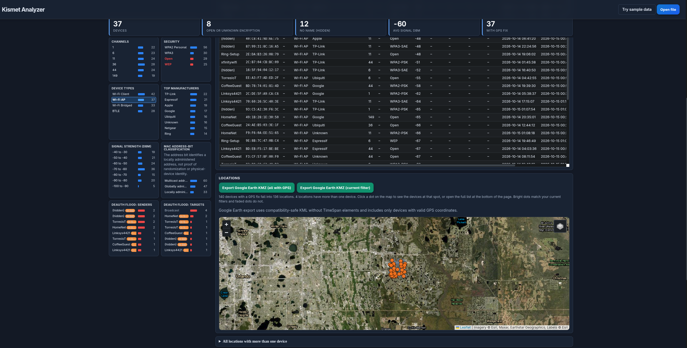
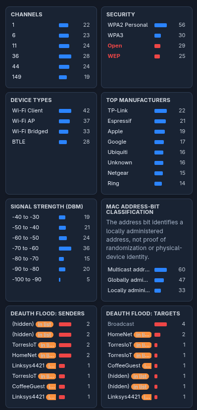
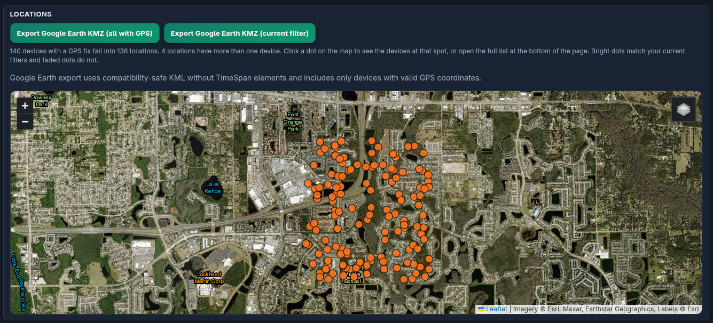

# Kismet Analyzer

Browser-based dashboard for Kismet, NeoStumbler, and WiGLE exports.

## Use

1. Open `kismet-analyzer.html` in a modern browser (or use GitHub Pages).
2. Drop a `.kismet`, `.netxml`, JSON, WiGLE CSV, or NeoStumbler CSV.
3. Files are parsed **only in your browser** — nothing is uploaded.

## Features

- Multi-file merge, filters, charts
- GPS map + Google Earth KMZ export
- Deauth flood sender/target views
- CSV / JSON / MAC list export

## Screenshots

